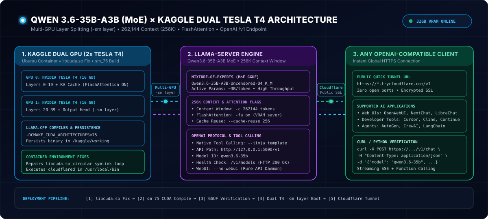

# ⚡ Qwen3.6-35B-A3B (MoE) on Kaggle Dual NVIDIA Tesla T4 (2x 16GB)

<p align="center">
  
</p>

<p align="center">
  <a href="https://www.kaggle.com/"></a>
  <a href="https://developer.nvidia.com/cuda-gpus"></a>
  <a href="https://huggingface.co/HauhauCS/Qwen3.6-35B-A3B-Uncensored-HauhauCS-Aggressive"></a>
  <a href="https://github.com/ggerganov/llama.cpp"></a>
  <a href="https://developers.cloudflare.com/cloudflare-one/connections/connect-networks/"></a>
  <a href="./LICENSE"></a>
</p>

---

## 📋 Overview

This repository provides a battle-tested, standalone automation pipeline for running **Qwen3.6-35B-A3B-Uncensored** (Mixture-of-Experts, GGUF Q4_K_M) across **Dual NVIDIA Tesla T4 GPUs (32 GB total VRAM)** on free Kaggle notebook instances.

It splits model layers across both Turing GPUs (`-sm layer`), enables FlashAttention (`-fa on`), allocates an ultra-long **262,144 token context window (256K)**, repairs broken Ubuntu container `libcuda.so` symlinks, caches the compiled `llama.cpp` binary in persistent storage, and exposes an **OpenAI-compatible `/v1` endpoint** over a high-speed Cloudflare Quick Tunnel.

---

## 🚀 Quickstart (1-Click Run)

### 1. Configure Kaggle Notebook Settings
In your Kaggle Notebook's right settings panel:
- **Accelerator:** `GPU T4 x2` (Enables dual 16 GB Tesla T4 GPUs = 32 GB total VRAM)
- **Internet:** `ON` (Required for downloading packages, model weights, and Cloudflare tunnel)
- **Persistence:** `Files only` (Preserves compiled `llama.cpp` in `/kaggle/working` between notebook sessions)

### 2. Import and Run
Upload and open `kaggle/Qwen36_35B_Kaggle_Dual_T4.ipynb` on Kaggle, or create a code cell and paste the contents of `kaggle/qwen36_t4x2_server.py`, then run it.

```bash
# Wait for the tunnel log to display:
======================================================================
  PUBLIC OPENAI-COMPATIBLE ENDPOINT (CLOUDFLARE TUNNEL)
======================================================================
  URL: https://<your-unique-tunnel-id>.trycloudflare.com
  Base API: https://<your-unique-tunnel-id>.trycloudflare.com/v1
  Chat API: https://<your-unique-tunnel-id>.trycloudflare.com/v1/chat/completions
  Models:   https://<your-unique-tunnel-id>.trycloudflare.com/v1/models
======================================================================
```

---

## 🏛️ Multi-GPU Architecture

| Component | Specification | Purpose |
| :--- | :--- | :--- |
| **Model** | `Qwen3.6-35B-A3B-Uncensored` (Q4_K_M) | 35B total parameters MoE architecture with ultra-dense active expert routing. |
| **GPU #0** | NVIDIA Tesla T4 (16 GB GDDR6) | Turing sm_75 compute, holds first half of transformer layers & KV cache. |
| **GPU #1** | NVIDIA Tesla T4 (16 GB GDDR6) | Turing sm_75 compute, holds remaining transformer layers & output head. |
| **Layer Splitting** | `llama-server -sm layer` | True tensor layer distribution balancing VRAM evenly across both devices (~10.5 GB each). |
| **Attention Engine** | FlashAttention (`-fa on`) | Drastically reduces quadratic attention VRAM consumption for 256K context. |
| **Context Window** | `262,144 tokens` (256K) | Full long-context support with dynamic context fallback if memory bounds require. |
| **Public Gateway** | **Cloudflare Quick Tunnel** | Instant HTTPS trycloudflare.com URL without firewall configuration or port forwarding. |

---

## ⚡ Key Engineering Highlights

1. **Automatic Kaggle `libcuda.so` Symlink Repair:**
   Kaggle container environments frequently experience broken circular symlinks pointing `/usr/lib/x86_64-linux-gnu/libcuda.so` to `/usr/local/cuda/compat/lib.real/libcuda.so.1`. The script locates the genuine driver binary, corrects the link table, and updates `ldconfig` before compilation.

2. **Targeted Turing Compilation (`sm_75`):**
   CMake builds `llama.cpp` targeting `-DCMAKE_CUDA_ARCHITECTURES=75` with `-DGGML_CUDA=ON`, ensuring maximum compute density and tensor core utilization on Tesla T4 silicon without wasted compilation time for unneeded architectures.

3. **Kaggle `noexec` & Permission Hardening:**
   Kaggle's `/kaggle/working` partition can strip execution flags (`noexec`) upon session restoration. The script caches the `cloudflared` binary in `/kaggle/working` but automatically stages and executes it from `/usr/local/bin` with `chmod 0o755` permissions.

4. **Multi-GB Weight Allocation Awareness:**
   `/kaggle/working` has a hard 20 GiB disk limit, while the Qwen 35B Q4_K_M GGUF file is ~21 GiB. The script detects `/kaggle/input` datasets first; if not mounted, it downloads to the larger `/tmp/models` partition, preventing out-of-disk termination errors.

---

## 🔌 API Client Integration

Because `llama-server` provides complete OpenAI-compatible endpoints (`/v1/chat/completions`, `/v1/models`), you can plug the generated Cloudflare URL directly into any OpenAI SDK, Curl, or GUI client.

### 1. Testing with `curl` (Streaming Output)

```bash
curl -N https://<your-tunnel-id>.trycloudflare.com/v1/chat/completions \
  -H "Content-Type: application/json" \
  -H "Authorization: Bearer sk-local" \
  -d '{
    "model": "qwen3.6-35b",
    "messages": [
      {"role": "system", "content": "You are a helpful and direct coding assistant."},
      {"role": "user", "content": "Write a quick Python script to calculate Fibonacci numbers with memoization."}
    ],
    "temperature": 0.7,
    "stream": true
  }'
```

### 2. Testing with Official Python `openai` SDK

```python
import os
from openai import OpenAI

# Replace with your actual Cloudflare Tunnel URL from the notebook output
BASE_URL = "https://<your-tunnel-id>.trycloudflare.com/v1"

client = OpenAI(
    base_url=BASE_URL,
    api_key="sk-local"  # llama-server accepts any dummy key by default
)

response = client.chat.completions.create(
    model="qwen3.6-35b",
    messages=[
        {"role": "system", "content": "You are an expert systems software engineer."},
        {"role": "user", "content": "Explain how multi-GPU tensor layer splitting works in llama.cpp."}
    ],
    temperature=0.6,
    stream=True
)

for chunk in response:
    content = chunk.choices[0].delta.content or ""
    print(content, end="", flush=True)
print()
```

---

## 📁 Repository Structure

```
qwen36-35b-kaggle-dual-t4/
├── docs/
│   └── assets/
│       └── architecture-animated.svg      # High-Resolution Animated SVG Diagram
├── kaggle/
│   ├── Qwen36_35B_Kaggle_Dual_T4.ipynb    # Clean One-Click Jupyter Notebook
│   └── qwen36_t4x2_server.py              # Full Hardened Multi-GPU Server Script
├── test/
│   ├── repository-sanity.ps1              # Windows/PowerShell Integrity Test Suite
│   └── repository-sanity.test.js          # Cross-Platform Node.js Test Suite
├── LICENSE                                # MIT License
└── README.md                              # Setup & Deployment Guide
```

---

## 🧪 Automated Testing

This repository includes automated integrity test suites verifying zero credential leaks, valid multi-GPU flags, container compatibility, clean notebook structures, and SVG well-formedness:

```bash
# Node.js Test Runner:
node --test

# Or on Windows PowerShell:
powershell -ExecutionPolicy Bypass -File test/repository-sanity.ps1
```

---

## 👨‍💻 Author

Developed and maintained by **Rogério Vigilato Rodrigues Filho** ([@rogeriovigilato](https://github.com/rogeriovigilato)).

---

## 📄 License

Released under the [MIT License](./LICENSE).
